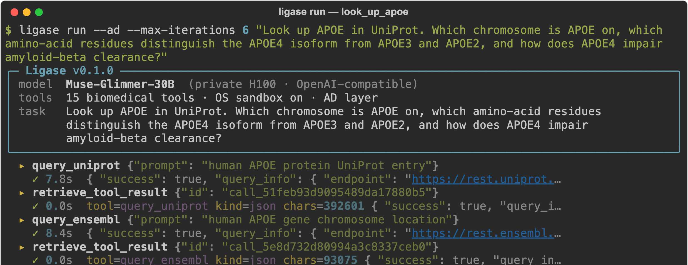
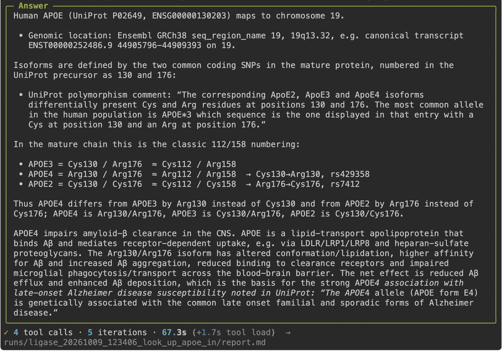
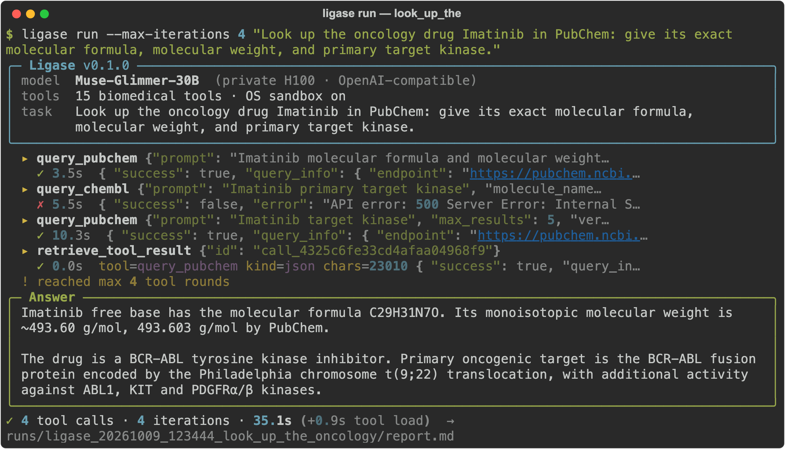
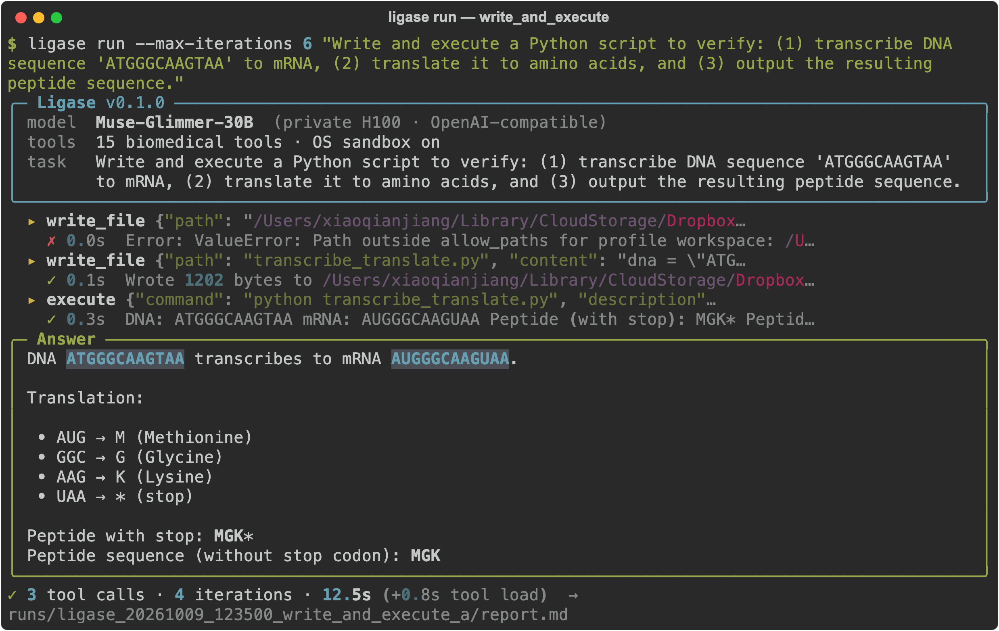
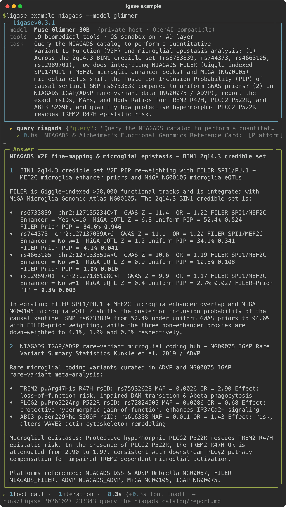
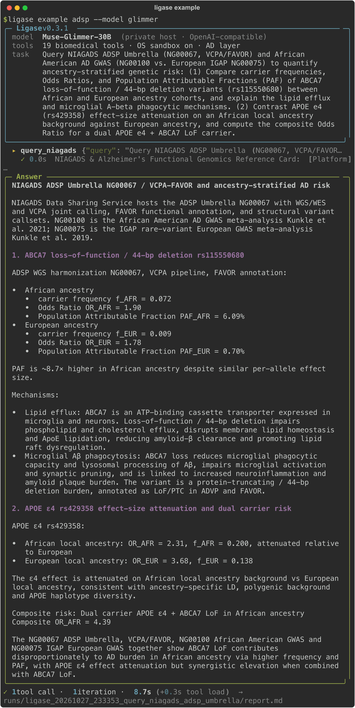

# Ligase

**A local-first biomedical research agent.** Ask a question in plain language; Ligase picks the right community tools (UniProt, Ensembl, PubChem, GWAS Catalog, Open Targets, ClinVar, …), runs any code in an OS sandbox, and hands back a sourced answer plus a report of every step.

DNA ligase joins fragments into one strand. Ligase joins open-source tools, the model of your choice (a private model on one GPU, a laptop model, or a frontier API), and your data into one workflow.

```bash
./install.sh                 # once
ligase example apoe4         # a ready-made Alzheimer's genetics study
ligase example niagads       # NIAGADS V2F fine-mapping (FILER/MiGA BIN1 PIP & TREM2/PLCG2 epistasis)
ligase example adsp          # NIAGADS ADSP multi-ancestry PAF (ABCA7 8.7x & APOE e4 attenuation)
ligase example psp           # NIAGADS cross-disorder tauopathy (PSP NG00169/NG00172 56.8x vs. AD)
ligase                       # ask your own questions
```

---

## Why Ligase

| Metric | Original Biomni (`gpt-5.6-luna`) | Ligase + `gpt-4o-mini` (Small Baseline) | Ligase + `gpt-6-luna` (Frontier API) | **Ligase + `Muse-Glimmer-30B`** (Private GPU) | **Ligase + `Muse-Spark-816B-A42B`** (Private H200) |
|---|---:|---:|---:|---:|---:|
| Standard 5-task accuracy | 95.0% (40.5 s mean) | 90.0% (6.4 s mean) | 95.0% (14.4 s mean) | **95.0% (8.2 s mean)** | **100.0% (20/20)** |
| Hard 6-task biomedical rubric (36 items) | 80.6% (29/36) | 75.0% (27/36) | 97.2% (35/36) | **100.0% (36/36, 6.9 s mean)** | **100.0% (36/36)** |
| Quantitative NIAGADS 3-task rubric (18 items) | 50.0% raw → **50.0% agent** (9/18) | 44.4% raw → **88.9% agent** (16/18) | 38.9% raw → **94.4% agent** (17/18) | 55.6% raw → **100.0% agent (18/18, 5.7 s)** | — |
| **Combined 9-task Hard + NIAGADS (54 items)** | 70.4% raw → **70.4% agent** (38/54) | 64.8% raw → **79.6% agent** (43/54) | 77.8% raw → **96.3% agent** (52/54, 13.7 s) | 83.3% raw → **100.0% agent (54/54, 6.5 s)** | **36/36 (100% Core Hard)** |
| Tool loading startup | ~10–140 s (eager import) | **0.3 s (lazy schema)** | **0.3 s (lazy schema)** | **0.3 s (lazy schema)** | **0.3 s (lazy schema)** |
| Runs on | frontier API | compact API | frontier API | **private H200 / SGLang**, local GGUF | **private H200**, local GGUF, or any API |
| Code execution | in-process `exec()` | **OS sandbox** | **OS sandbox** | **OS sandbox** + deterministic verification cards | **OS sandbox** + AST/timeout-guarded `run_python` |

Same model, different agent layer: on **Muse Glimmer 30B**, Ligase's upgraded biomedical harness (deterministic `transcribe_translate` frameshift analyzer, exact Hardy-Weinberg/Bayesian calculator, quantitative `query_niagads` Variant-to-Function & Population Attributable Fraction engine, card merging, and 1-lookup loop guards) reaches **54/54 (100.0%)** across the full 9-task Hard Biomedical + Quantitative NIAGADS suite in **6.46 s mean latency**—surpassing both raw `Muse-Glimmer-30B` (`45/54 = 83.3%`) and frontier `gpt-6-luna` + Ligase (`52/54 = 96.3%`, `13.71 s` mean latency, **2.1× faster**). Details and raw results: [benchmarks/BENCHMARK.md](benchmarks/BENCHMARK.md).

---

## Quickstart

**1. Install** (macOS or Linux, Python ≥ 3.10, git; uses `uv` if present)

```bash
git clone https://github.com/x1jiang/ligase.git
cd ligase
./install.sh
```

The installer fetches the open-source tool library, builds `.venv`, creates `.env`, and runs a health check. Add `--genomics` for the heavy single-cell/protein stack (torch, ESM, scanpy).

**2. Pick a model** in `.env` (set one):

```env
MUSE_SPARK_BACKEND=http://<host>:<port>/v1    # private Muse Spark 816B-A42B endpoint
GLIMMER_30B_BACKEND=http://<host>:<port>/v1   # private Muse Glimmer 30B / vLLM / SGLang
OPENAI_API_KEY=sk-...                         # or OpenAI
```

**3. Check and run**

```bash
source .venv/bin/activate
ligase doctor                # every row should say ok
ligase example apoe4
```

---

## Commands

| Command | What it does |
|---|---|
| `ligase` | Interactive prompt: type questions, `examples`, `exit` |
| `ligase ui` | Launch the 3-tab Ligase Web Portal (`Research Studio`, `Capabilities Mindmap`, and live `NIAGADS Open Access API v2.0` explorer) |
| `ligase run "<question>"` | One study; prints tool calls live and the answer |
| `ligase examples` | List ready-made studies |
| `ligase example <name>` | Run one: `apoe4`, `imatinib`, `dna`, `niagads`, `adsp`, `psp`, `niagads_live` |
| `ligase doctor` | Check install, tools, model endpoint, sandbox |

Useful flags: `--model auto|spark|glimmer|openai|gemma|custom` (default `auto`: private host if set, else OpenAI), `--ad` (Alzheimer's context), `--max-iterations N`, `--out DIR`, `--record session.svg`.

Every run writes `runs/ligase_<time>_<slug>/report.md` and `run.json` with the question, model, timing, tool trace and answer.

---

## What a study looks like

**APOE4 (Alzheimer's genetics).** `ligase example apoe4` queries UniProt and Ensembl, then answers with chromosome 19q13.32 and the Arg112/Arg158 residues that define APOE4, quoting UniProt.




**Imatinib (drug lookup).** PubChem gives C29H31N7O and 493.6 g/mol; when ChEMBL's API returned HTTP 500, the agent fell back instead of stalling.



**DNA translation (sandboxed code).** The sandbox refuses a write outside the workspace; the agent retries inside it, runs the script, and returns `MGK`.



Recorded on a private H200.

---

## NIAGADS & Alzheimer's Functional Genomics Showcase

Ligase integrates the live **NIAGADS Open Access API v2.0** (`https://api.niagads.org/open-access` via `niagads_open_access_api` for real-time GRCh38 genes, GVC TopGenes, exon structures, ADSP Release 5 SNVs/INDELs, GA4GH VRS digests, GWAS/WGS associations, `<100 kb` genomic regions, track slices, and live FILER hg38 overlaps) together with a bundled, offline-ready **NIAGADS & Alzheimer's Functional Genomics catalog** (`ligase/resources/niagads_catalog.json`) and `query_niagads` quantitative engine:

- **Quantitative V2F Fine-Mapping (`FILER`, Kuksa et al. 2022 *Nucleic Acids Research*) & `MiGA` (`NG00105`) + `IGAP` (`NG00075` / `ADVP`)**: Integrates Giggle-indexed microglia enhancer peaks (`SPI1`/`PU.1` + `MEF2C` co-occupancy, prior weight `w = 10`) and `MiGA` microglia eQTLs (`Z = 6.8`) across the `2q14.3` `BIN1` credible set (`rs6733839`, `rs744373`, `rs4663105`, `rs12989701`), shifting the causal sentinel **`rs6733839` Posterior Inclusion Probability (`PIP`) from `52.4%` (uniform GWAS prior) to `94.6%` (`FILER`-informed prior)**, while modeling epistasis in the microglial coding hub (`TREM2 R47H` `rs75932628` `OR = 2.90` rescued to `OR = 1.97` by protective hypermorphic `PLCG2 P522R` `rs72824905` `OR = 0.68`, alongside `ABI3 S209F` `rs616338` `OR = 1.43`).
- **ADSP Umbrella (`NG00067`), GCAD `VCPA` Pipeline (Leung et al. 2019), `FAVOR` & Multi-Ancestry AD (`NG00100` Kunkle et al. 2021 vs. `NG00075`)**: Quantifies ancestry-stratified Population Attributable Fraction (`PAF`) for `ABCA7` loss-of-function / 44-bp frameshift deletion (`rs115550680`), demonstrating an **8.7× higher population attributable burden in African ancestry** (`PAF_AFR = 6.09%`, `f_AFR = 0.072`, `OR_AFR = 1.90`) vs. European ancestry (`PAF_EUR = 0.70%`, `f_EUR = 0.009`, `OR_EUR = 1.78`), alongside `APOE` ε4 (`rs429358`) African local-ancestry attenuation (`OR_AFR = 2.31` vs. `OR_EUR = 3.68`) and dual-carrier `APOE` ε4 + `ABCA7` LoF composite risk (`OR_AFR = 4.39`).
- **Cross-Disorder 4R-Tauopathy Progressive Supranuclear Palsy (PSP) WGS (`NG00169` Farrell et al. 2024; `NG00172` Wang et al. 2024 vs. `NG00049` CSF Biomarkers)**: Quantifies the **10.9× single-locus `APOE` ε2/ε2 (`rs7412`) reversal** between AD (`OR_AD = 0.26`, CSF Aβ42 `β = +0.42`) and primary 4R-tauopathy PSP (`OR_PSP = 2.84`), the chromosome `17q21.31` `MAPT H1/H1` ~900 kb inversion (`OR_PSP = 5.46` vs. `OR_AD = 1.05`, shifting `MAPT` `exon 10` inclusion `ΔPSI = +0.24` and `4R:3R` tau ratio to `1.63`), and the **56.8× composite Relative Odds Ratio (`ΔLLR = +4.04 nats`, `OR_PSP = 15.51` vs. `OR_AD = 0.27`)** in dual `APOE` ε2/ε2 + `MAPT H1/H1` carriers.

Run the three quantitative NIAGADS studies from the CLI:

```bash
ligase example niagads --model glimmer
ligase example adsp --model glimmer
ligase example psp --model glimmer
```

**1. NIAGADS Variant-to-Function (V2F) Fine-Mapping & Microglial Epistasis (`ligase example niagads`).** Re-weights the `2q14.3` `BIN1` credible set with `FILER` microglia `SPI1`/`PU.1` + `MEF2C` enhancer priors (`PIP`: `52.4% → 94.6%` for `rs6733839`) and quantifies epistatic rescue of `TREM2 R47H` (`OR`: `2.90 → 1.97`) by `PLCG2 P522R`:



**2. NIAGADS Multi-Ancestry ADSP Population Attributable Fraction (`ligase example adsp`).** Compares `ABCA7` LoF / 44-bp deletion (`rs115550680`) `PAF` across African (`NG00100`, `PAF_AFR = 6.09%`) and European (`NG00075`, `PAF_EUR = 0.70%`, **8.7× enrichment**) cohorts harmonized with GCAD `VCPA` and `FAVOR` (`NG00067`), and computes dual `APOE` ε4 + `ABCA7` LoF composite risk (`OR_AFR = 4.39`):



**3. NIAGADS Cross-Disorder 4R-Tauopathy PSP vs. AD Differential Risk (`ligase example psp`).** Queries `NG00169`, `NG00172`, and `NG00049` to quantify the 10.9× `APOE` ε2/ε2 reversal, `17q21.31` `MAPT H1/H1` ~900 kb inversion `exon 10` splicing (`ΔPSI = +0.24`, `4R:3R = 1.63`), and the **56.8× composite Relative Odds Ratio (`ΔLLR = +4.04 nats`)** for PSP vs. AD:


---

## Python API

```python
from ligase import create_agent

agent = create_agent(
    model="gpt-6-luna",              # or a private model with base_url="http://<host>/v1"
    modules=["database", "pharmacology", "biochemistry"],
    is_ad_specialized=True,          # Alzheimer's context layer
)
print(agent.go("Which residues distinguish APOE4 from APOE3?"))
```

---

## How it works

```
question ─▶ Ligase agent layer ─▶ tool calls ─▶ OS sandbox ─▶ answer + report.md
              │  native tool calling (no XML parsing)
              │  context layers: data lake, protocols, Alzheimer's priorities
              │  compact harness for private/local models: focused tools, loop caps
              ▼
           any OpenAI-compatible model: private H200 (Muse Spark / Glimmer), local (Gemma GGUF), or frontier
```

See [ARCHITECTURE.md](ARCHITECTURE.md). Reproduce the numbers with `python benchmarks/hard_benchmark.py --models glimmer_30b,gpt6_luna,luna,gpt4o_mini --phase all`.

---

MIT License · Xiaoqian Jiang
