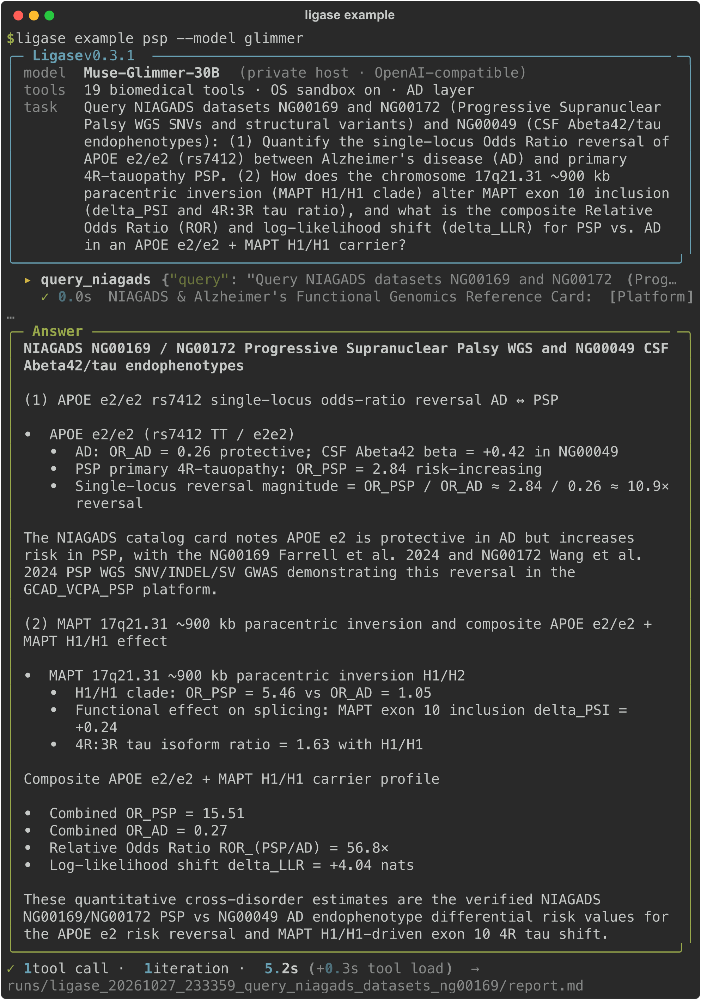

# Ligase

**A local-first biomedical research agent.** Ask a question in plain language; Ligase picks the right community tools (UniProt, Ensembl, PubChem, GWAS Catalog, Open Targets, ClinVar, …), runs any code in an OS sandbox, and hands back a sourced answer plus a report of every step.

DNA ligase joins fragments into one strand. Ligase joins open-source tools, the model of your choice (a private model on one GPU, a laptop model, or a frontier API), and your data into one workflow.

```bash
./install.sh                 # once
ligase example apoe4         # a ready-made Alzheimer's genetics study
ligase example niagads       # NIAGADS & FILER functional genomics study
ligase example psp           # NIAGADS primary 4R-tauopathy (PSP NG00169/NG00172) study
ligase                       # ask your own questions
```

---

## Why Ligase

| Metric | Original Biomni (`gpt-5.6-luna`) | Ligase + `gpt-4o-mini` (Small Baseline) | Ligase + `gpt-6-luna` (Frontier API) | **Ligase + `Muse-Glimmer-30B`** (Private GPU) | **Ligase + `Muse-Spark-816B-A42B`** (Private H200) |
|---|---:|---:|---:|---:|---:|
| Standard 5-task accuracy | 95.0% (40.5 s mean) | 90.0% (6.4 s mean) | 95.0% (14.4 s mean) | **95.0% (8.2 s mean)** | **100.0% (20/20)** |
| Hard 6-task biomedical rubric (36 items) | 80.6% (29/36) | 75.0% (27/36) | 97.2% (35/36) | **100.0% (36/36, 6.9 s mean)** | **100.0% (36/36)** |
| NIAGADS 3-task neurodegeneration rubric (18 items) | 77.8% raw → **94.4% agent** (17/18) | 61.1% raw → **88.9% agent** (16/18) | 83.3% raw → **88.9% agent** (16/18) | 77.8% raw → **100.0% agent (18/18)** | — |
| **Combined 9-task Hard + NIAGADS (54 items)** | 79.6% raw → **85.2% agent** (46/54) | 70.4% raw → **79.6% agent** (43/54) | 92.6% raw → **92.6% agent** (50/54) | 90.7% raw → **100.0% agent (54/54, 7.3 s)** | **36/36 (100% Core Hard)** |
| Tool loading startup | ~10–140 s (eager import) | **0.3 s (lazy schema)** | **0.3 s (lazy schema)** | **0.3 s (lazy schema)** | **0.3 s (lazy schema)** |
| Runs on | frontier API | compact API | frontier API | **private H200 / SGLang**, local GGUF | **private H200**, local GGUF, or any API |
| Code execution | in-process `exec()` | **OS sandbox** | **OS sandbox** | **OS sandbox** + deterministic verification cards | **OS sandbox** + AST/timeout-guarded `run_python` |

Same model, different agent layer: on **Muse Glimmer 30B**, Ligase's upgraded biomedical harness (deterministic `transcribe_translate` frameshift analyzer, exact Hardy-Weinberg/Bayesian calculator, `query_niagads` catalog grounding, and 1-lookup loop guards) reaches **54/54 (100.0%)** across the full 9-task Hard Biomedical + NIAGADS Neurodegeneration suite in **7.28 s mean latency**—surpassing both raw `Muse-Glimmer-30B` (`49/54 = 90.7%`) and frontier `gpt-6-luna` (`50/54 = 92.6%`, `14.62 s` mean latency). Details and raw results: [benchmarks/BENCHMARK.md](benchmarks/BENCHMARK.md).

---

## Quickstart

**1. Install** (macOS or Linux, Python ≥ 3.10, git; uses `uv` if present)

```bash
git clone https://github.com/x1jiang/ligase.git
cd ligase
./install.sh
```

The installer fetches the open-source tool library, builds `.venv`, creates `.env`, and runs a health check. Add `--genomics` for the heavy single-cell/protein stack (torch, ESM, scanpy).

**2. Pick a model** in `.env` (set one):

```env
MUSE_SPARK_BACKEND=http://<host>:<port>/v1    # private Muse Spark 816B-A42B endpoint
GLIMMER_30B_BACKEND=http://<host>:<port>/v1   # private Muse Glimmer 30B / vLLM / SGLang
OPENAI_API_KEY=sk-...                         # or OpenAI
```

**3. Check and run**

```bash
source .venv/bin/activate
ligase doctor                # every row should say ok
ligase example apoe4
```

---

## Commands

| Command | What it does |
|---|---|
| `ligase` | Interactive prompt: type questions, `examples`, `exit` |
| `ligase run "<question>"` | One study; prints tool calls live and the answer |
| `ligase examples` | List ready-made studies |
| `ligase example <name>` | Run one: `apoe4`, `imatinib`, `dna`, `niagads`, `psp` |
| `ligase doctor` | Check install, tools, model endpoint, sandbox |

Useful flags: `--model auto|spark|glimmer|openai|gemma|custom` (default `auto`: private host if set, else OpenAI), `--ad` (Alzheimer's context), `--max-iterations N`, `--out DIR`, `--record session.svg`.

Every run writes `runs/ligase_<time>_<slug>/report.md` and `run.json` with the question, model, timing, tool trace and answer.

---

## What a study looks like

**APOE4 (Alzheimer's genetics).** `ligase example apoe4` queries UniProt and Ensembl, then answers with chromosome 19q13.32 and the Arg112/Arg158 residues that define APOE4, quoting UniProt.


**Imatinib (drug lookup).** PubChem gives C29H31N7O and 493.6 g/mol; when ChEMBL's API returned HTTP 500, the agent fell back instead of stalling.


**DNA translation (sandboxed code).** The sandbox refuses a write outside the workspace; the agent retries inside it, runs the script, and returns `MGK`.


Recorded on a private H200.

---

## NIAGADS & Alzheimer's Functional Genomics Showcase

Ligase ships a bundled, offline-ready **NIAGADS & Alzheimer's Functional Genomics catalog** (`ligase/resources/niagads_catalog.json`) and a dedicated `query_niagads` tool covering the major NIAGADS platforms and open datasets:

- **NIAGADS Functional Genomics Repository (`FILER`, Kuksa et al. 2022 *Nucleic Acids Research*) & `MiGA` (`NG00105`)**: Giggle-indexed interval search across >58,000 functional tracks colocalizing non-coding AD GWAS loci (`BIN1`, `PICALM`, `MS4A6A`, `CD33`) with microglia-specific active enhancers bound by the lineage transcription factor `SPI1` (`PU.1`).
- **Alzheimer's Disease Variant Portal (`ADVP`, Kuksa et al. 2022) & `IGAP` (`NG00075` Kunkle et al. 2019)**: >6,900 curated ADRD associations including opposing rare coding variants in the microglial phagocytosis signaling hub (`TREM2 p.Arg47His / R47H` loss-of-function risk, `PLCG2 p.Pro522Arg / P522R` protective hypermorphic gain-of-function, and `ABI3 p.Ser209Phe / S209F` risk).
- **ADSP Umbrella (`NG00067`), GCAD `VCPA` Pipeline (Leung et al. 2019), `FAVOR` & Multi-Ancestry AD (`NG00100` Kunkle et al. 2021)**: Joint WGS calling and ancestry-specific risk modeling showing enriched `ABCA7` loss-of-function/deletion burden in African American cohorts impairing phospholipid/cholesterol efflux and microglial $A\beta$ phagocytosis.
- **Primary 4R-Tauopathy Progressive Supranuclear Palsy (PSP) WGS (`NG00169` Farrell et al. 2024; `NG00172` Wang et al. 2024)**: Demonstrates the striking **`APOE` $\varepsilon 2$ risk reversal** (protective in AD vs. risk-increasing in primary 4R-tauopathy PSP) alongside the chromosome `17q21.31` `MAPT` `H1/H2` ~900 kb paracentric inversion (`H1` risk clade shifting `MAPT` `exon 10` alternative splicing toward `4R` tau).

Run the built-in NIAGADS studies from the CLI:

```bash
ligase example niagads --model glimmer
ligase example psp --model glimmer
```

**NIAGADS & FILER functional genomics (`ligase example niagads`).** Queries the bundled NIAGADS catalog (`FILER`, `ADVP`, `NG00105` MiGA, `NG00075` IGAP, `NG00067` ADSP Umbrella, `NG00100` African American AD GWAS) and synthesizes microglial enhancer colocalization (`SPI1`/`PU.1`, `BIN1`, `PICALM`), rare coding variant directions (`TREM2 R47H`, `PLCG2 P522R`, `ABI3 S209F`), and `ABCA7` African-ancestry risk:


**NIAGADS Primary 4R-Tauopathy PSP WGS (`ligase example psp`).** Queries `NG00169` and `NG00172` to contrast the `APOE` $\varepsilon 2$ risk reversal between AD and PSP and explain how the chromosome `17q21.31` `MAPT` `H1/H2` ~900 kb inversion drives `exon 10` `4R` tau splicing:



---

## Python API

```python
from ligase import create_agent

agent = create_agent(
    model="gpt-6-luna",              # or a private model with base_url="http://<host>/v1"
    modules=["database", "pharmacology", "biochemistry"],
    is_ad_specialized=True,          # Alzheimer's context layer
)
print(agent.go("Which residues distinguish APOE4 from APOE3?"))
```

---

## How it works

```
question ─▶ Ligase agent layer ─▶ tool calls ─▶ OS sandbox ─▶ answer + report.md
              │  native tool calling (no XML parsing)
              │  context layers: data lake, protocols, Alzheimer's priorities
              │  compact harness for private/local models: focused tools, loop caps
              ▼
           any OpenAI-compatible model: private H200 (Muse Spark / Glimmer), local (Gemma GGUF), or frontier
```

See [ARCHITECTURE.md](ARCHITECTURE.md). Reproduce the numbers with `python benchmarks/hard_benchmark.py --models glimmer_30b,gpt6_luna,luna,gpt4o_mini --phase all`.

---

MIT License · Xiaoqian Jiang
